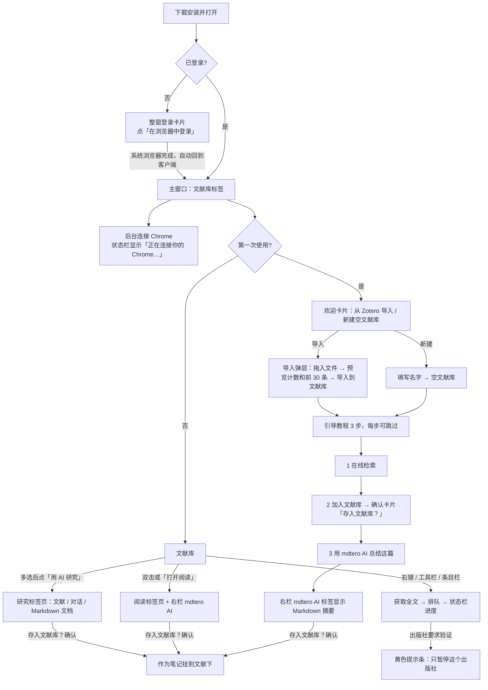

# mdtero 桌面客户端 · 首次使用与主窗口设计规格（v3）

> 状态：设计稿，待工程评审。日期：2026-10-23。
> 适用范围：doi2md 仓库的 Tauri 客户端（`connect/`），以及换肤后的后端 MCP 页面。
> 配套文件：
> - `shared-components-spec.md`：共享组件库规格
> - `components.css`：组件 CSS 草案
> - `mcp-reskin/mcp-reskin.css`：MCP 页面换肤变量映射
> - `mocks/`：28 张 PNG，1280×800，浅色和深色各一套
> - `build3.py`：设计稿的生成脚本
> - `mcp-ref/`：现有 MCP UI 的本地渲染参考图
>
> 所有颜色、字号、间距都写 token 名，取值见 `/workspace/mdtero-tokens.css`。设计稿里的文献来自 `ui-mock/graph-data.json`，作者统一写成「示例作者」，正文是占位文字。

## 0. 定稿的方向（按 Jianbin 的最新意见，前后有冲突时以这里为准）

1. **主窗口只有三类内容：文献库、阅读、mdtero AI。**
   - 主窗口里不放任何配置。
   - 顶部不放账号、全文出口开关和语言切换。
   - 设置放在单独的「设置」窗口里，分 6 页：通用、账号、mdtero AI、全文出口、高级、关于。
2. **骨架采用 Zotero 式三栏，组件采用 MCP UI 的。**
   - 三栏是：左边分类树，中间文献表，右边条目栏。
   - 窗口顶部是标签条：第一个标签是「文献库」，每打开一篇论文或一次研究，就多一个标签。
   - 卡片、按钮、状态胶囊、确认卡片、底部弹层、引导块等组件，沿用 `mdtero-backend/service/mcp_ui/` 现有组件，统一换成砖红 tokens 和官网 logo。
   - 只借鉴 Zotero 的交互思路，不拿它的代码、CSS 和图标。
3. **登录参考 Zotero 的同步账号。**
   - 没登录时，窗口正中只有一张登录卡片，点击后用系统浏览器登录。
   - 登录后，账号入口在两个地方：左栏左下角的头像行，和「设置 › 账号」。
4. **重要操作不能只放在菜单栏。**
   - 登录、导入、获取全文、用 AI 研究，都必须在界面上有看得见的按钮、右键菜单项或卡片。
   - 系统菜单栏只当快捷键的镜像。
5. **mdtero AI 要放在显眼的位置。**
   - 右栏顶部有两个标签：「信息」和「mdtero AI」。选中文献时，默认打开 mdtero AI。
   - 中间工具栏有醒目的「用 AI 研究」按钮，点了以后打开研究标签页。
6. **全文出口的开关放在设置里，默认是「自动」。** 切换出口或出口离线时，只在窗口底部状态栏提示一下。

## 1. 流程

**10 分钟最小闭环**，对应 PRD §5：

> 安装 → 整窗登录 → 后台自动接上 Chrome → 选「从 Zotero 导入」或「新建空文献库」 → 3 步引导 → 确认加入第一篇 → 右栏出现 mdtero AI 生成的摘要。

## 2. 窗口骨架（1280×800 基准，最小 1024×680）

| 区域 | 尺寸 | Token / 说明 |
|---|---|---|
| 标签条 `.tabs` | 高 40 | 底色 `--bg`，底线 `--line`。左边留 84px 给系统窗口按钮。 标签高 31，选中时 32，圆角 8 8 0 0，最大宽 230，字号 12。 选中标签：底色 `--surface`、边框 `--line`、字重 600。 文献库标签用 16px 官网 logo，研究标签用 ✦，阅读标签用文档图标，后两种可以关闭。 |
| 左栏 `.lp` | 宽 230（`--sidebar-w`） | 底色 `--muted`，右边线 `--line`。 |
| 中栏 `.mp` | 自适应，最小 520 | 底色 `--surface`。 |
| 右栏 `.rp` | 宽 352（阅读标签页里是 380） | 底色 `--surface`，左边线 `--line`。宽度可以拖动，范围 300–480。 |
| 状态栏 `.sbar` | 高 30 | 字号 12，文字色 `--quiet`。左边显示队列进度，右边显示出口切换等一次性提示。 |

**窗口变窄时：**
- 宽度小于 1180：右栏改成浮层，选中文献时滑出，Esc 关闭。
- 宽度小于 1024：左栏收成 48px 图标栏。

### 2.1 左栏（Zotero 式分类树）

**分类树** `.ti`：
- 行高 26，圆角 6，字号 13，图标 15，每级缩进 14，展开箭头 11。
- 第一层是「我的文献库」（显示计数），下面依次是：最近阅读、各个分类（可以多层）、未分类、回收站。
- 选中项：底色 `--accent-soft`，文字 `--accent-ink`，字重 600，图标用 `--accent`。

**标签区** `.tagbox`：
- 位于左栏底部，上边有一条线。
- 彩色标签排在第一行，每个标签是一个 9px 圆点加名字。
  - 默认 4 个：精读 `--error`、已读 `--ok`、待读 `--warn`、组会 `--accent`。
  - 颜色只从 tokens 的语义色里选。
- 普通标签显示为文字，最多两行，超出部分滚动。
- 最下面是「筛选标签」输入框，高 26。

**账号行** `.acct`：
- 位于左栏最下面，高 48。
- 内容是头像（28px，底色 `--accent-soft`）、名字和「已登录 · 账号与设置」，右边一个齿轮。
- 点击后打开「设置 › 账号」。

**改动说明：**
- 和 MCP UI 相比，保留了：侧栏底色和选中态（`.lib-rail`、`.rail-item`），以及标签胶囊（`.tag-filter-pill`）。
- 改动的是：
  - 原来「科研工作区 / 收件箱 / 找文献 / 上传 PDF」这几个入口，换成 Zotero 式分类树。找文献合并进搜索框的「在线检索」。上传 PDF 去掉，因为界面里不能出现 PDF。
  - 「合集」改名为「分类」。
  - 底部原来是格言，现在换成账号行。

### 2.2 中栏

**工具栏** `.tb`：
- 高 46，按钮都是 `.btn.sm`（高 28），从左到右依次是：
  1. 「导入」：打开导入弹层，弹层里默认是 Zotero 导入。
  2. 「获取全文」：作用于当前选中的文献，没有选中时置灰。
  3. 「✦ 用 AI 研究」：`.btn.primary`，是整个窗口里唯一的实心主按钮。
  4. 一条竖分隔线。
  5. 「全文状态：全部 ▾」：`.btn.quiet`，下拉选项有：全部 / 全文已就绪 / 仅元数据 / 排队中·获取中 / 本批。「仅元数据」下有一个子筛选「有失败原因」，用来找上次没取到的文献。（按 PRD 5.4，「获取失败」不是文献状态，不出现在这个下拉里。）
  6. 右侧是搜索框，宽 214、高 28，底色 `--muted`。前面有范围下拉「文献库 ▾ / 在线检索」，占位文字是「标题、作者、DOI…」。快捷键 ⌘F 聚焦搜索框；⌘K 打开在线检索。

**文献表** `table.zt`：
- 表头高 28，字号 11.5，字重 600，文字色 `--quiet`，列之间有竖线。
- 行高 28，字号 12.5，偶数行底色是 `--muted` 的 55%。

列宽：

| 列 | 宽度 |
|---|---|
| 全文状态图标 | 30 |
| 标题 | 自适应 |
| 年 | 52 |
| 作者 | 96 |
| 类型 | 70 |
| 出版物 | 124 |
| 添加日期 | 90，默认按它倒序 |

- 每一列都可以排序、拖动改宽度、右键表头隐藏。
- 「修改日期」列默认隐藏，可以在表头右键菜单里打开。

选中态：
- 当前焦点行：底色 `--accent`，文字 `--on-accent`。
- 其他被选中的行：底色 `--accent-soft`，文字 `--accent-ink`。
- 多选方式：Shift 连选，⌘ 或 Ctrl 加选，⌘A 全选。

**全文状态图标**用来替代 Zotero 的 PDF 图标，15px，线宽 1.9，必须带 `title` 和 `aria-label`：

| 状态 | 图形 | 颜色 | 悬停说明 |
|---|---|---|---|
| 全文已就绪 | 圆圈里一个勾 | `--ok` | 全文已就绪 · 来源：出版社 XML |
| 仅元数据 | 虚线文档 | `--quiet` | 仅元数据 · 还没获取全文 |
| 排队中 | 虚线圆 | `--quiet` | 排队中 · 第 N 个 |
| 获取中 | 3/4 圆弧，旋转 | `--accent` | 获取中… |
| 仅元数据（附失败原因） | 虚线文档，右下角一个 `--error` 小圆点 | `--quiet` | 仅元数据 · 出版社未开放全文 |

文献状态只有 4 种（PRD 5.4）：全文已就绪、仅元数据、排队中、获取中。获取失败的文献回到「仅元数据」，在右栏「全文」区显示「仅元数据 · <原因>」，例如「仅元数据 · 出版社未开放全文」，下面是「重试」按钮（主按钮）和「换全文出口」。

**获取队列和底部状态栏**用另一套任务状态，共 5 种：

| 任务状态 | 图形 | 颜色 | 说明 |
|---|---|---|---|
| 排队中 | 虚线圆 | `--quiet` | 第 N 个 |
| 获取中 | 3/4 圆弧，旋转 | `--accent` | — |
| 等待验证 | 三角形 | `--warn`（黄色） | 单独一种，不算排队中：需要用户去 Chrome 里操作 |
| 已完成 | 圆圈里一个勾 | `--ok` | — |
| 获取失败 | 圆圈里一个感叹号 | `--error` | 获取失败 · 原因（白话） |

「本批」视图里的行图标显示任务状态；其他视图显示文献状态。状态栏在进度条右边显示计数，如「已完成 4 · 获取失败 1」「等待验证 3」。

**改动说明：**
- 和 MCP UI 相比，保留了：
  - 工具栏里的搜索框和排序（`.lib-toolbar`、`.list-filter`）；
  - 筛选里的状态下拉（`#filter-status`），文献状态 4 种，另有「本批」视图；
  - 选中态的颜色语义（`.document-row.is-selected`）。
- 改动的是：
  - 原来是 78px 高的卡片式行，改成 28px 的 Zotero 式表格。
  - 列标题从「标题 / 作者 / 年份 / 期刊」，扩成 Jianbin 要的 6 列，再加一个状态图标列。
  - 原来标题区的「全部文献」大标题和「添加文献」主按钮，改成上面说的工具栏。

### 2.3 右栏

顶部 `.rtabs` 高 46，里面是一个分段控件 `.seg`（高 32）：「ⓘ 信息 | ✦ mdtero AI · N 篇」。

**默认打开哪个标签：**
- 没选中文献：信息标签，显示空状态「选择一篇文献」。
- 选中 1 篇：信息标签。
- 选中 2 篇及以上：mdtero AI 标签。
- 用户手动切换后，这次会话内记住用户的选择。

**信息标签**：
- 内容区内边距 14 16。右边缘有一条竖向分区导航 `.vnav`，宽 38，按钮 28×28：信息、摘要、笔记、标签、相关。点按钮会滚到对应分区，当前分区的按钮用 `--accent-soft` 底色。
- 标题字号 15，字重 650。
- 「全文」块 `.ftbox`：
  - 底色 `--muted`，圆角 `--r-md`。
  - 内容是状态胶囊、来源说明和动作按钮。
    - 来源说明用 micro 字号，例如「来源：出版社 XML · 经由：本机直连」。
    - 已就绪时，动作是「打开阅读」（主按钮）和「用 mdtero AI 总结」。
    - 仅元数据时，动作是「获取全文」（主按钮）。
- 「信息」分区是一个键值网格：标签列宽 66，右对齐，文字色 `--quiet`。字段有：条目类型、作者（每人一行）、出版物、日期、DOI（链接色）、被引、添加日期、标签（chip）。
- 「摘要」「笔记」分区可以折叠。

**mdtero AI 标签**的结构从上到下是：
1. 一行小字说明：「选中的 N 篇会作为上下文。」
2. 一键任务卡片 `.pcard`：两列网格，间距 8，每张卡片有图标、标题和一行说明。
   - 总结摘要：每篇 3 句话 + 关键结论
   - 比较方法：对比实验条件与方法
   - 提取参数：把关键参数整理成表
   - 更多…：研究空白、综述草稿…
3. 消息流：
   - 用户消息右对齐，底色 `--accent-soft`。
   - 每一步是一张可折叠的步骤卡片 `.step`（高 30），状态分三种：✓ 完成（`--ok`）、⟳ 进行中（`--accent`）、！失败（`--error`）。展开后显示引用了哪些段落，比如「§2.1 浸渍法…」。
   - AI 的回答以 Markdown 显示，引用写成 `§`，点击后跳到原文对应段落。
4. 输入卡片 `.inbox`：
   - 固定在底部，阴影用 `--shadow-pop`。
   - 第一行是论文 chip，每个最宽 132，带 ×。中间表格里多选了哪些，这里就是哪些，两边同步。
   - 下面是输入区，最少两行。
   - 最底下一行是「mdtero AI · 今日还可用 N 次」和发送按钮（30×30，`--accent`）。
   - 不显示任何模型名。如果在设置里切换成了用户自己的账号，这里显示提供方的名字，比如「OpenRouter · 模型名」。
5. 同时最多选 10 篇。超过时，右键菜单里的「用 mdtero AI 研究」置灰，并提示「最多 10 篇」。

**改动说明：**
- 和 MCP UI 相比，保留了：
  - 右侧的「文献信息」检查器（`.inspector`）和它的键值网格（`.metadata-grid`）；
  - 状态胶囊（`.status-pills`）；
  - 阅读页的 AI 区块（`.reader-ai-panel`），以及它的预设按钮（概括研究 / 解释方法 / 分析局限），这次改成卡片。
- 新增的是：右栏顶部的双标签、竖向分区导航、步骤卡片和输入卡片。

## 3. 各屏规格

> 每屏都标出两类内容：「沿用 MCP」表示结构和组件照搬 MCP UI，「新增 / 改」表示这次加的或改的。

### 3.1 登录（`01-login`）

- 整窗只有标签条（只留系统窗口按钮），底色 `--bg`，正中放一张 `.authcard`。
- 卡片宽 420，圆角 `--r-lg`，内边距 28/28/22，阴影 `--shadow-pop`。
  - 品牌行：logo 36px、「mdtero」（18px，字重 650），下面一行小字「文献库 · 全文 · mdtero AI」。
  - 标题「登录 mdtero」：22/30。
  - 说明文字（small，`--quiet`）。
  - 「在浏览器中登录」按钮：`.btn.primary.lg.block`，高 44，前面带外链图标。
  - 按钮下面一行 micro 小字：「会打开系统浏览器，登录完成后自动回到这里。」
  - 一条分隔线，下面左边是「还没有账号？注册」（链接色），右边是「中文 / EN」。
- 窗口底部居中一行 micro 字：「mdtero 0.1.0 内测版 · 帮助 · 隐私」。

状态：

| 状态 | 表现 |
|---|---|
| 默认 | 如设计稿 |
| 等待浏览器 | 按钮变成 disabled，文案改为「正在等待浏览器登录…」并显示转圈；下面出现文字按钮「重新打开浏览器」和「取消」 |
| 成功 | 卡片淡出 160ms，进入主窗口 |
| 失败或超时（5 分钟） | 卡片内出现 `.notice.error`「没有完成登录，请再试一次。」，按钮恢复 |
| 离线 | `.notice.warn`「网络好像断了，连上后再登录。」，按钮置灰 |

- **沿用 MCP**：`auth_chrome.css` 的卡片结构，也就是品牌行加 h1 加说明加主按钮。原来的 Georgia 字体和深绿色都换掉。
- **新增 / 改**：
  - 去掉 Google、GitHub、邮箱这几种登录方式，一律交给系统浏览器里的网页登录页。
  - 不放在顶栏，也不依赖菜单栏。

### 3.2 欢迎（`02-welcome`，只在第一次出现）

- 主窗口已经显示，左栏的树只有「我的文献库 0 / 最近阅读 / 回收站」。
- 中栏正中：
  - 标题「欢迎，<名字>。从哪里开始？」：22/30。
  - 副标题：「只在第一次出现。之后随时可以点工具栏的『导入』。」
  - 两张选择卡片 `.choice`：每张宽 290，间距 16，圆角 `--r-lg`，内边距 24，悬停时 1px `--accent` 描边并加阴影。
    - 「从 Zotero 导入」：拖入 Zotero 导出的文件，先预览、确认后才导入。只导入题录信息，全文之后按需获取。
    - 「新建空文献库」：起个名字就能开始，接着带你检索并加入第一篇论文。
  - 卡片下面留一个隐藏位，给以后的「检测到本机 Zotero」。
- 状态栏左侧显示「⟳ 正在连接你的 Chrome…」，连上后改为「已连接你的 Chrome」，3 秒后淡出。
- 右栏是信息标签的空状态。

新建空文献库：
- 点卡片后，卡片原地展开出一个 `.field`：「文献库名称」，默认值「我的文献库」，旁边是「创建」主按钮。
- 名字为空时按钮置灰。
- 名字重复时，在字段下面用 `--error` 色提示「已经有同名的文献库」。

- **沿用 MCP**：
  - 空文献库的引导块（`.nav-empty`），也就是标题加说明加按钮组；
  - `.intake-options` 和 `.intake-option` 两栏选择卡片，这次放大成 `.choice`。
- **新增 / 改**：
  - 只保留两张卡片。
  - 原来的「先配置 Elsevier key / Relay」这类内部说法全部去掉。

### 3.3 导入预览（`03-import-preview`）

导入弹层用 `.sheet`：宽 900，圆角 `--r-lg`，内边距 22/24。遮罩是 `rgba(28,22,18,.34)`，Esc 关闭。内部分左右两栏：左 270，右自适应。

**左栏：**
- 文件拖放区 `.drop`，有三种状态：
  - 空：虚线框，写「拖入导出文件，或点这里选择」。
  - 拖拽悬停：描边改成 `--accent`，底色改成 `--accent-soft`。
  - 已有文件（filled）：显示文件图标、文件名、「1.8 MB · 612 篇 · 分 2 批」和「换一个」。
- 支持格式的说明（micro）：BibTeX、RIS、Zotero JSON、CSL JSON。如果拖入的是 Zotero RDF，会出现 `.notice.warn`「Zotero RDF 暂不支持，请改导出 BibTeX。」
- 「怎么从 Zotero 导出」三步图示 `.steps3`，序号圆点 20px：
  1. 在 Zotero 里右键「我的文库」或某个分类
  2. 选「导出文库…」
  3. 格式选 BibTeX，点确定
- 「导入到」下拉：可以选「我的文献库」或某个分类。默认是「我的文献库 / 新分类『<文件名>』」。

**右栏：**
- 「共 N 篇」，旁边小字「预览前 30 篇」。
- 一排计数胶囊：可导入 / 已存在 / 重复 / 跳过，后面跟着跳过的原因。
- 前 30 条：每行高 30，内容是序号、标题（单行省略）、出版物 · 年（宽 150）和一个胶囊（可导入 / 重复 / 已存在 / 跳过）。
- 最下面是一条进度条：「已读取 x/y 批」。

**底部：**
- 左边：「只导入题录信息，不会自动获取全文。」
- 右边：「取消」和「导入到文献库（N 篇）」。

批次规则（沿用 intake.js）：
- 每批不超过 1 MiB 或 500 条，客户端自动切分。
- 每批先 dry_run 预览，确认后用同一个 request_id 提交。
- 只有一条总进度条，不显示「第几批」这类细节。
- 目标：500 条在 1 分钟内完成。

状态：

| 状态 | 表现 |
|---|---|
| 读取中 | 右栏换成骨架行，同时显示「正在读取…」 |
| 空文件或格式不对 | `.notice.error`「没读到文献。请确认导出格式是 BibTeX、RIS 或 Zotero JSON。」 |
| 可导入为 0 | 主按钮置灰（不隐藏），文案「没有可导入的文献」 |
| 提交中 | 主按钮显示转圈，文案「正在导入 120/587」，弹层不能关闭，但可以「在后台继续」 |
| 完成 | 弹层关闭；状态栏提示「已导入 587 篇」；如果是首次，接着进入引导 |
| 部分失败 | `.notice.warn`「587 篇里 580 篇已导入，7 篇没导入」，旁边「查看」按钮展开原因 |

错误码对应的白话说明：
- `import_too_large`：自动切批，不会提示用户。
- `too_many_items`：同上，自动切批。
- `project_not_found`：「这个分类不见了，请重新选择」。
- `request_id_conflict`：静默重试一次，还是失败就提示「导入没完成，请再试一次」。

- **沿用 MCP**：
  - intake.js 的状态机（预览 → 确认），以及它的计数文案（可导入 · 已有 · 重复 · 跳过）和「前 30 条」；
  - `.intake-card` 的结构：文件选择、「保存位置」下拉、上限说明；
  - `.sheet` 和 `.sheet-card`。
- **新增 / 改**：
  - 去掉「运行 mdtero zotero import --json」「zotero.org API key」「粘贴导出内容」这几项。
  - 新增拖放区、三步图示和单一进度条。
  - 「确认加入文献库」改为「导入到文献库（N 篇）」。

### 3.4 文献库 + 右键菜单 + 队列（`04-library`）

**右键菜单** `.menu`：宽 248，项高 30，分组之间用 `.sep` 隔开。顺序是：

1. 打开阅读 ↵
2. 用 mdtero AI 研究（多选超过 10 篇时置灰，右边写「最多 10 篇」）
3. ——
4. **获取全文（N 篇）** ⌘⇧F（这一组只有这一项，用 `.on` 高亮）
5. ——
6. 加入分类 ▸
7. 添加标签…
8. 移到回收站… ⌫
9. ——
10. 导出 Markdown…
11. 导出 BibTeX…
12. 在出版社页面打开（没有 DOI 或网址时置灰）

规则：
- 不能用的项一律置灰，不隐藏（透明度 `--disabled-opacity`）。
- 多选时，已有全文的文献会静默跳过，菜单里的 N 只算需要获取的篇数。如果 N = 0，这一项置灰，并写「都已有全文」。

**「获取全文」有 4 个入口：**
- 右键菜单
- 工具栏按钮
- 条目栏「全文」块里的按钮
- 阅读标签页顶部（只对仅元数据的文献显示）

**超过 20 篇时**，先弹 `.confirm`：

> 将按顺序获取 N 篇，大约需要 X 分钟，期间请保持 Chrome 打开。

按钮是「取消」和「开始获取」。没有硬性上限。

**队列显示在状态栏**（`.sbar` 左侧）：

> ⟳ **正在获取全文 5/12** · 经由 实验室台式机 [进度条 120px] [暂停] [取消] 只看这批

- 「只看这批」：把中栏筛到这一批，工具栏的筛选按钮显示「全文状态：本批 12 篇」。
- 「暂停」后变成「继续」。
- 「取消」要二次确认：「剩下 7 篇不取了？」
- 队列结束时，状态栏提示「12 篇里 9 篇已就绪」，旁边「查看没取到的」会筛出「仅元数据 › 有失败原因」里这一批的文献。这条提示保留 10 秒。
- 进度文本放在 `aria-live="polite"` 区域里。

**重启后**，状态栏出现 `.notice.info`：

> 上次有 N 篇没取完，继续吗？

按钮是「继续」和「不用了」。

节奏规则（PRD 5.4，用户看不到这些数字）：
- 同一个出版社的两次请求之间，随机间隔 3–5 秒。
- 同一个出版社连续失败 3 次，就暂停这个出版社，状态栏提示「<出版社> 连续失败，已暂停，其他照常」。
- 全文来源的优先顺序：开放 XML → 出版社 HTML（通过 Chrome 或全文出口） → PDF 解析（最后才用）。

- **沿用 MCP**：
  - 多选后底部出现的托盘（`.selection-tray`）。它的位置和样式用来放队列条，并移到状态栏。
  - `library-actions.js` 里已有的分类、标签、删除、导出这些动作。
- **新增 / 改**：右键菜单、全文状态图标列、状态栏队列、超过 20 篇的确认、重启后的询问。

### 3.5 出版社要求验证（`05-captcha-bar`）

- 中栏工具栏下面插入一条 `.notice.warn`（外边距 8 10 6）：

  > ⚠ **出版社要求验证，请在 Chrome 里完成后点继续。** ScienceDirect 的 3 篇已暂停。

  右边是「打开 Chrome」（`.btn.sm`）和「继续」（`.btn.sm.primary`）。
- 只暂停这一个出版社。表格里对应的行显示「等待验证」三角图标，其他出版社照常获取。
- 状态栏显示「⏸ 已暂停 ScienceDirect · 正在获取全文 5/12」。
- 「本批」里获取失败的行悬停时，出现说明卡（宽 300）：标题「获取失败 · 需要机构登录」，正文「在 Chrome 里登录学校账号后，右键『获取全文』重试。这篇在文献库里仍显示为『仅元数据』。」
- 状态栏右侧显示出口提示：「⇄ 实验室台式机离线，已改用本机」。这条提示保留 10 秒，期间点它会打开「设置 › 全文出口」。
- 不绕过验证码，也不自动重试验证。

- **沿用 MCP**：连接横幅（`.connection-banner`）的位置和形态，也就是正文上方的一条全宽提示，这次换成 warn 配色。
- **新增 / 改**：按出版社分别暂停，以及「打开 Chrome」和「继续」两个按钮。

### 3.6 右栏 mdtero AI（`06-ai-pane`）

- 中间表格选中 3 行（`.sel`），右栏自动切到「mdtero AI · 3 篇」。
- 结构见 §2.3。设计稿展示的是正在执行「比较方法」：两步已完成，一步进行中。

状态：

| 状态 | 表现 |
|---|---|
| 空 | 只显示任务卡片和输入卡片 |
| 运行中 | 发送按钮变成「停止」（方形图标） |
| 部分文献只有元数据 | 消息流顶部出现 `.notice.info`「有 2 篇还没有全文，只能根据摘要回答。」，旁边按钮「先获取全文」 |
| 今日次数用完 | 输入卡片变成 disabled，并显示「今天的 mdtero AI 次数用完了，明天 0 点恢复。也可以在设置里连接你自己的账号。」，后面跟链接「去设置」 |
| 出错 | 对应的步骤卡片显示！，文案「这一步没完成」，旁边「重试」；不显示任何调试信息 |

- **沿用 MCP**：`.reader-ai-panel` 的预设动作，以及 `.context-card`（当前上下文是什么）。
- **新增 / 改**：做成右栏标签页，加上任务卡片、步骤卡片、带 chip 的输入卡片和次数显示。

### 3.7 研究标签页（`07-research-tab`）

- 点工具栏「用 AI 研究」或右键「用 mdtero AI 研究」，会新开一个标签「✦ 研究：<任务名>」。
- 三栏布局：250 | 自适应 | 440。
  - **左栏「这次研究的文献 · N」**：
    - 每篇是一张 `.pcard`：标题最多两行，下面是出版物 · 年和状态胶囊。
    - 底部「+ 添加文献」按钮，也支持从文献库标签拖进来。
  - **中栏对话**：
    - 顶部一行 micro 字「研究：方法对比 · 今天 17:42」。
    - 消息流和步骤卡片同 §2.3。
    - 回答后面跟着「接着：…」的建议 chip。
    - 底部是固定的输入卡片。
  - **右栏 Markdown 文档**：
    - 头部是「📄 方法对比.md」和 `.badge`「未保存」。
    - 正文是渲染后的 Markdown，支持表格、列表、`§` 引用上标和 KaTeX。
    - 底部条高 52：「编辑」「导出 .md」，以及主按钮「存入文献库…」。
- 点「存入文献库…」后弹出 `.confirm`：「『方法对比.md』会作为笔记，挂在这 3 篇文献下面。」，按钮是「取消」和「存入」。
- 导出只有 .md 一种格式。
- **全部是新增**。MCP 只有在对话宿主里的上下文，没有独立的研究页。

### 3.8 阅读标签页（`08-reader-ai`）

- 双击文献，或点「打开阅读」，会新开一个阅读标签（标题截断到 26 字）。
- 两栏布局：阅读区 | 右栏 380（默认打开 mdtero AI）。
- 阅读区：
  - 顶部 `.tb`：面包屑「文献库 › 阅读」，右侧依次是「目录」「在文中查找」和主按钮「✦ 用 mdtero AI 研究这篇」。如果这篇只有元数据，在主按钮左边多一个「获取全文」。
  - 正文最大宽 780，左右内边距 44。
    - 标题 22/30。
    - 下面是作者 · 出版物 · 年 · DOI（small，`--quiet`）。
    - 再下面是状态胶囊和来源行（micro），例如：
      - 「来源：出版社 XML · 经由：实验室台式机」
      - 「来源：PDF 解析（排版可能有误）」：这是界面里唯一允许出现 PDF 字样的地方。
    - Markdown 正文：14.5/25，公式用 KaTeX 渲染。
- 右栏：
  - 预设 chip：总结摘要（选中态）/ 比较方法 / 提取参数 / 更多…
  - 结果是 Markdown（带 `§` 出处），下面是「编辑」「导出 .md」「存入文献库…」，存入同样要确认。
  - 底部是带本篇 chip 的输入卡片。

- **沿用 MCP**：
  - 阅读器整体：`.reader-bar` 工具栏、`.markdown` 排版、`paper-math.js` 和 KaTeX、目录（`.contents`）、文中查找（`.search-box`）、文献信息抽屉；
  - 「在对话中翻译」改名为「翻译」，作为 v1.1 的功能保留。
- **新增 / 改**：
  - 新增来源行和「经由」。
  - 右侧 AI 栏代替原来正文里的 AI 区块。
  - 「加入合集」挪进右键菜单。

### 3.9 引导教程（`09-tour-step2`）

一共 3 步，每一步都能跳过；之后可以在「设置 › 关于 › 帮助与教程」重新打开。

1. **检索**：聚焦中栏的搜索框，范围切到「在线检索」。气泡写「输入研究主题，先找一篇论文。」
2. **加入文献库**：
   - 聚光圈套住第一条结果的「加入文献库」按钮：3px `--accent` 描边，外面加一层半透明暗色遮罩。
   - 点击后，按钮下方 10px 出现确认卡片「存入文献库？」，右侧 352px 处是引导气泡（`.tour.left`）。
   - 不确认就不会写入。
3. **总结**：聚焦右栏的「总结摘要」卡片。气泡写「用 mdtero AI 总结这篇」，完成后出现摘要，引导结束。

引导气泡 `.tour`：
- 宽 300，底色 `--ink`，文字 `--bg`，带箭头。
- 底部一行：3 个进度点、「跳过教程」、「下一步」。
- Esc 等于跳过，Enter 等于下一步。

- **沿用 MCP**：
  - 找文献的结果卡片（`.discovery-card`），也就是标题、元信息和动作行。原来的按钮「加入上下文以获取全文」改成「加入文献库」。
  - 教程卡片的编号样式（`.guide-num`）。
- **新增 / 改**：聚光圈、气泡、确认卡片的组合。

### 3.10 设置窗口（`10`–`14`）

- 设置是一个独立窗口（设计稿按 1280×800 渲染，实际默认 860×620，可以缩放）。
- 布局：左侧导航 200（底色 `--muted`，项高 32），右侧内容区，内边距 52 40。
- 内容区：
  - 每页 h1 是 22/30，下面跟一行说明（small）。
  - 分组用 `.sec` 卡片：最大宽 720，圆角 `--r-md`。
  - 卡片里是 `.srow` 行：上下内边距 13，左边是图标或单选框，中间是名称加说明，右边是操作按钮。
- 打开设置的入口：左栏的账号行或齿轮、关于里的教程入口，以及快捷键 ⌘,。菜单栏只做镜像。

| 页 | 内容 |
|---|---|
| **通用** | 界面语言（中文 / English）、外观（跟随系统 / 浅色 / 深色）、启动时打开上次的标签。没有设计稿 |
| **账号**（`10`） | 头像、名字、邮箱、「已同步 N 分钟前」；「在浏览器管理账号」；「退出登录」（要二次确认）。同步：自动同步开关、「立即同步」。用量：mdtero AI 今日剩余次数和进度条 |
| **mdtero AI**（`11`） | 见下文 |
| **全文出口**（`12`） | 见下文 |
| **高级**（`13`） | 连接状态：Chrome 连接（已连接 / 未连接，加「重新连接」）、当前全文出口（「自动 → 本机直连」，加「去设置」）。获取全文：请求间隔 3–5 秒（只读）、连续失败 3 次暂停（开关）、重启后询问（开关）。问题反馈：导出诊断信息（只包含状态和错误编号） |
| **关于**（`14`） | 64px logo、「mdtero」、「0.1.0 内测版 · 0.1.0 Beta」。下面是：检查更新、开源许可（显示 THIRD_PARTY_NOTICES）、隐私与条款、帮助与教程（重新打开引导） |

**mdtero AI 页**（`11`）：
- 没有任何填写密钥的输入框。
- 第一块：mdtero AI（内置，无需设置，显示今日剩余次数），默认选中，带「正在使用」徽标。
- 第二块「用自己的账号」：
  - OpenRouter 和 GitHub Copilot：通过系统浏览器 OAuth，或者设备码授权。
    - 已连接时显示「已连接 · <模型>」，按钮是「换模型」和「断开」。
    - 等待授权时，显示设备码 `.kbd`，按钮是「复制代码」和「取消」。
  - ChatGPT 订阅和 Claude 订阅：标 `.badge.exp`「实验」。
- 最下面的说明：「登录凭据只保存在这台电脑的系统钥匙串里，不会上传到 mdtero。」
- 每行左边的单选框决定用哪个作为默认。

**全文出口页**（`12`）：
- 单选列表：
  - 自动（默认，徽标「默认」）
  - 本机直连
  - 我的各台设备：显示在线或离线、延迟，或者「12 分钟前在线」；可以「重命名」「移除」
- 下面是「+ 添加出口…」。点击后显示设备码配对：在要添加的那台电脑上打开 mdtero，输入 8 位配对码。
- 页底是 `.notice.info`：「只能添加你自己的设备，仅供你的账号使用。设备离线时会自动改用下一个，并在窗口底部提示。」
- 界面里不出现 VPN、relay 之类的字眼。

- **沿用 MCP**：
  - settings.html 的分区方式（h2 分区加卡片行）、`.status-grid` 状态卡片、设备行（DeviceRow）和服务行（ServiceKeyRow）的结构；
  - 从 `mdtero-ui-components.md` 来的 QuotaBar，即用量条。
- **新增 / 改**：
  - 原来的单页长表单拆成 6 个分页。
  - Elsevier key、Wiley token、Relay 安装命令这些内容，从普通用户界面里移走，交给工程决定放在哪（见 §7 的问题 4）。

## 4. 文案表（中 / 英）

| 位置 | 中文 | English |
|---|---|---|
| 登录标题 | 登录 mdtero | Sign in to mdtero |
| 登录按钮 | 在浏览器中登录 | Sign in with your browser |
| 登录说明 | 会打开系统浏览器，登录完成后自动回到这里。 | We'll open your browser and bring you back here when you're done. |
| 登录等待 | 正在等待浏览器登录… | Waiting for your browser… |
| 登录失败 | 没有完成登录，请再试一次。 | Sign-in didn't finish. Please try again. |
| 注册 | 还没有账号？注册 | No account? Sign up |
| 桥接中 | 正在连接你的 Chrome… | Connecting to your Chrome… |
| 桥接成功 | 已连接你的 Chrome | Connected to your Chrome |
| 欢迎标题 | 欢迎，{name}。从哪里开始？ | Welcome, {name}. Where would you like to start? |
| 卡片 1 | 从 Zotero 导入 | Import from Zotero |
| 卡片 2 | 新建空文献库 | Start an empty library |
| 导入弹层标题 | 从 Zotero 导入 | Import from Zotero |
| RDF 提示 | Zotero RDF 暂不支持，请改导出 BibTeX。 | Zotero RDF isn't supported yet. Please export as BibTeX. |
| 导出步骤 | 在 Zotero 里右键「我的文库」/ 选「导出文库…」/ 格式选 BibTeX，点确定 | Right-click "My Library" in Zotero / Choose "Export Library…" / Pick BibTeX and click OK |
| 计数 | 共 {n} 篇 · 可导入 · 已存在 · 重复 · 跳过 | {n} items · Ready · Already in library · Duplicates · Skipped |
| 导入按钮 | 导入到文献库（{n} 篇） | Import {n} items |
| 只导元数据 | 只导入题录信息，不会自动获取全文。 | Only citation info is imported. Full text is fetched later, when you ask. |
| 工具栏 | 导入 / 获取全文 / 用 AI 研究 / 全文状态：{x} | Import / Get full text / Research with AI / Full text: {x} |
| 搜索 | 文献库 ▾ · 标题、作者、DOI… / 在线检索 | Library ▾ · Title, author, DOI… / Search online |
| 列名 | 标题 / 年 / 作者 / 类型 / 出版物 / 添加日期 | Title / Year / Creator / Type / Publication / Date Added |
| 文献状态 | 全文已就绪 / 仅元数据 / 排队中 / 获取中 | Full text ready / Metadata only / Queued / Fetching |
| 失败原因 | 仅元数据 · 出版社未开放全文 / 重试 | Metadata only · Publisher has no open full text / Retry |
| 任务状态 | 排队中 / 获取中 / 等待验证 / 已完成 / 获取失败 | Queued / Fetching / Needs verification / Done / Couldn't fetch |
| 右键 | 打开阅读 / 用 mdtero AI 研究 / 获取全文 / 加入分类 / 添加标签… / 移到回收站… / 导出 Markdown… / 导出 BibTeX… | Open / Research with mdtero AI / Get full text / Add to collection / Add tag… / Move to Trash… / Export Markdown… / Export BibTeX… |
| 超过 20 篇的确认 | 将按顺序获取 {n} 篇，大约需要 {m} 分钟，期间请保持 Chrome 打开。 | We'll fetch {n} items one by one. This takes about {m} min. Please keep Chrome open. |
| 队列 | 正在获取全文 {i}/{n} · 经由 {route} | Fetching full text {i}/{n} · via {route} |
| 队列结束 | {n} 篇里 {k} 篇已就绪 | {k} of {n} ready |
| 重启 | 上次有 {n} 篇没取完，继续吗？ | {n} items didn't finish last time. Continue? |
| 验证 | 出版社要求验证，请在 Chrome 里完成后点继续。 | The publisher wants to verify you. Finish it in Chrome, then click Continue. |
| 验证按钮 | 打开 Chrome / 继续 | Open Chrome / Continue |
| 出口回退 | {device}离线，已改用本机 | {device} is offline. Using this computer instead. |
| 右栏标签 | 信息 / mdtero AI · {n} 篇 | Info / mdtero AI · {n} |
| 任务卡片 | 总结摘要 / 比较方法 / 提取参数 / 更多… | Summarize / Compare methods / Extract parameters / More… |
| 输入占位 | 问 mdtero AI，或点上面的任务… | Ask mdtero AI, or pick a task above… |
| 次数 | mdtero AI · 今日还可用 {n} 次 | mdtero AI · {n} left today |
| 次数用完 | 今天的 mdtero AI 次数用完了，明天 0 点恢复。 | You've used today's mdtero AI. It resets at midnight. |
| 存入确认 | 存入文献库？「{doc}」会作为笔记，挂在这 {n} 篇文献下面。 | Save to library? "{doc}" will be added as a note to these {n} items. |
| 阅读按钮 | 用 mdtero AI 研究这篇 | Research this paper with mdtero AI |
| 来源 | 来源：出版社 XML · 经由：{route} / 来源：PDF 解析（排版可能有误） | Source: publisher XML · via {route} / Source: PDF parsing (layout may be off) |
| 引导 | 第 {i} 步：… / 跳过教程 / 下一步 | Step {i}: … / Skip tour / Next |
| 设置分页 | 通用 / 账号 / mdtero AI / 全文出口 / 高级 / 关于 | General / Account / mdtero AI / Full-text route / Advanced / About |
| AI 设置 | 用自己的账号 / 已连接 · {model} / 断开 / 实验 | Use your own account / Connected · {model} / Disconnect / Experimental |
| 钥匙串说明 | 登录凭据只保存在这台电脑的系统钥匙串里，不会上传到 mdtero。 | Credentials stay in this computer's keychain and are never uploaded to mdtero. |
| 出口说明 | 只能添加你自己的设备，仅供你的账号使用。 | Only your own devices, for your account only. |
| 关于 | 0.1.0 内测版 / 开源许可 | 0.1.0 Beta / Open-source licenses |
| 通用错误 | 这一步没完成，请再试一次。 | That didn't work. Please try again. |

**用词禁区**：界面里不能出现以下词：Connect、relay、Pi、worker、R2、MCP 客户端、curl、PDF（来源行除外）、VPN，以及任何模型名称（用户自己连接的账号除外）。品牌名一律写小写的 mdtero。

## 5. 键盘与无障碍

**快捷键：**

| 快捷键 | 作用 |
|---|---|
| ⌘F | 搜索文献库 |
| ⌘K | 在线检索 |
| ⌘⇧F | 获取全文 |
| ⌘⇧A | 用 AI 研究 |
| ↵ | 打开阅读 |
| ⌘W | 关闭当前标签 |
| ⌘1…9 | 切换标签 |
| ⌘, | 设置 |
| ⌘I | 右栏切到信息 |
| ⌘J | 右栏切到 mdtero AI |
| Esc | 关闭菜单、弹层、确认卡片，或跳过引导 |
| ⌘↵ | 在输入卡片里发送 |

- 菜单栏里有这些快捷键的镜像，但每个操作在界面上都有按钮可点。

**文献表：**
- 用 `role="grid"`，方向键在行之间移动，Shift + 方向键连选，空格切换选中。
- 状态图标带 `aria-label`，例如「全文状态：仅元数据，出版社未开放全文」。
- 每种状态都同时有颜色、图形和文字说明，不只靠颜色区分。

**弹出层：**
- 右键菜单用 `role="menu"`，菜单项用 `menuitem`。
- 置灰项用 `aria-disabled="true"`，仍然可以聚焦，读屏会读出原因，比如「最多 10 篇」。

**焦点：**
- 焦点环一律用 `box-shadow: var(--focus-ring)`。
- `.sheet` 和设置窗口要把焦点锁在内部，关闭后焦点回到触发它的按钮。

**实时播报：**
- 队列进度、导入进度、出口回退、AI 步骤的状态，都放在 `aria-live="polite"` 区域里。
- 验证码提示条用 `role="alert"`。

**动效：**
- 开启 `prefers-reduced-motion` 时，关闭所有转圈和淡入淡出，转圈改用静态的「…」。

**对比度：**
- 正文和 `--quiet` 文字，在 `--surface` 和 `--muted` 底色上，浅色和深色模式都要达到 4.5:1。
- 深色模式下，主按钮文字用 `--on-accent: #1c1f1e`。

## 6. 验收清单（对齐 PRD §5 最小闭环）

**闭环（PRD §5，发布门槛）**
- [ ] 新用户在 10 分钟内完成整个流程：下载安装 → 整窗登录卡片（不在顶栏，也不依赖菜单栏） → 后台自动接上 Chrome（只在状态栏小字提示） → 选「从 Zotero 导入」或「新建空文献库」 → 引导 3 步，每步可跳过 → 确认后加入第一篇论文 → 右栏 mdtero AI 出现 Markdown 摘要。
- [ ] Jianbin 在内测版上走通上面的流程后，才进入小范围封闭测试。

**登录和账号**
- [ ] 没登录时，窗口正中是登录卡片，用系统浏览器登录后自动回到客户端。
- [ ] 登录后，账号只出现在左下角的账号行和「设置 › 账号」里。
- [ ] 主窗口顶部没有账号、配置、全文出口开关或语言切换。
- [ ] 登录、导入、获取全文、用 AI 研究，这四个操作都有界面上的按钮；菜单栏只是镜像。

**导入（PRD 5.2）**
- [ ] 支持 .bib、.ris、Zotero JSON、CSL JSON；拖入 RDF 时提示改导出 BibTeX。
- [ ] 按每批不超过 1 MiB 或 500 条自动分批，只显示一条进度条；500 条在 1 分钟内导完。
- [ ] 先预览（共 N / 可导入 / 已存在 / 重复 / 跳过，以及前 30 条），确认后才写入；可导入为 0 时主按钮置灰。
- [ ] 只导入题录信息，不会自动获取全文。

**三栏文献库**
- [ ] 左栏是分类树（我的文献库、最近阅读、各分类、未分类、回收站），底部是彩色标签、普通标签、标签筛选框和账号行。
- [ ] 中栏是可排序的表格（标题 / 年 / 作者 / 类型 / 出版物 / 添加日期），加一列全文状态图标；搜索框在右上。
- [ ] 右栏顶部有「信息」和「mdtero AI」两个标签；选中 2 篇及以上时默认显示 mdtero AI；信息标签右边缘有竖向分区导航。
- [ ] 顶部标签条：第一个是文献库，每打开一篇论文或一次研究就新增一个标签。

**获取全文（PRD 5.3 / 5.4）**
- [ ] 获取全文有 4 个入口：右键（单独一组）、工具栏、条目栏、阅读页顶部。
- [ ] 多选时已有全文的文献会静默跳过；不能用的菜单项置灰，不隐藏。
- [ ] 超过 20 篇时先确认（显示篇数、预计时长、保持 Chrome 打开），没有硬性上限。
- [ ] 按顺序获取；状态栏显示进度、经由哪个出口，可以暂停、取消、只看这批；结束时显示汇总。
- [ ] 每篇的文献状态是 4 种：排队中 / 获取中 / 全文已就绪 / 仅元数据（失败时附原因和「重试」）。队列里的任务状态是 5 种：排队中 / 获取中 / 等待验证（黄色）/ 已完成 / 获取失败（附原因）。
- [ ] 同一出版社请求间隔随机 3–5 秒；连续失败 3 次暂停这个出版社；遇到验证码只暂停这个出版社，显示黄色提示条，不绕过。
- [ ] 重启后询问「上次有 N 篇没取完，继续吗？」
- [ ] 文献库可以按全文状态筛选。
- [ ] 全文出口：不是 VPN，只访问出版社白名单域名，只能添加自己的设备，可以有多个；默认「自动」；用设备码配对；显示「经由：<出口名>」；离线时自动换到下一个，并在状态栏提示。
- [ ] 全文出口开关只在「设置 › 全文出口」里。

**mdtero AI（PRD 5.1）**
- [ ] 界面里不出现模型名；客户端不持有任何密钥；每个账号每天有次数上限，用完时用白话提示。
- [ ] 右栏 AI 标签有：一键任务卡片、带可折叠步骤卡片的消息流、底部固定的输入卡片，输入卡片里的论文 chip 和表格的多选同步。
- [ ] 工具栏的「用 AI 研究」打开研究标签页（文献 / 对话 / Markdown 文档）。
- [ ] 结果都是 Markdown，可以编辑、导出 .md；存入文献库前必须确认。
- [ ] 「设置 › mdtero AI」里没有密钥输入框；可以连接 OpenRouter 或 GitHub Copilot（OAuth 或设备码），ChatGPT 和 Claude 订阅标「实验」；凭据只存在本机钥匙串里。

**只用 Markdown（PRD 5.5）**
- [ ] 界面里除了来源行「来源：PDF 解析（排版可能有误）」，不出现 PDF 字样；只能导出 .md。
- [ ] 在开放获取回归集上，走 PDF 解析兜底的比例低于 10%（由工程侧测试）。

**统一外观（PRD 5.6）**
- [ ] 客户端只引用 doi2md/contracts/ 里的 tokens 和组件，不在别处写死色值；全部用砖红主色；品牌名一律小写 mdtero；logo 只用官网的 `brand-mark.svg`。
- [ ] 浅色和深色模式都通过对比度检查。
- [ ] P0：界面里没有原始错误信息和内部用词（见 §4 的用词禁区）。
- [ ] 关于页显示「0.1.0 内测版 / 0.1.0 Beta」，有「开源许可」入口，可以查看 THIRD_PARTY_NOTICES。
- [ ] 把 MCP 页面（登录、授权、设置、工作区）和客户端的截图并排放，看起来像同一个产品（详见 shared-components-spec §5）。

**暂不做**：Vercel Analytics；Apple 签名和公证。

## 7. 需要工程确认的问题

**10/23 已定的事**：
- `--muted` 在 MCP 里改名为 `--tk-muted`：已同意（产品经理）。
- Tauri 应用图标用 `brand-mark.svg` 重新生成：已同意（产品经理）。
- 官网页头把品牌名转成大写「Mdtero」的问题：已交给工程主管排进网站修复，品牌名一律小写 mdtero。

1. ~~**状态数量**~~ **已定（产品经理，10/23）**：文献状态保持 4 种；失败显示为「仅元数据 · <原因>」加「重试」。「获取失败」只出现在队列和状态栏。
2. ~~**「等待验证」**~~ **已定（产品经理，10/23）**：队列里单独一种任务状态，黄色，文案「等待验证」，不并入排队中。
3. **预计时长 X 分钟**：建议按「篇数 × 平均 4 秒，再加每篇实际下载时间的滑动平均」来算。需要拿到真实的平均值。
4. **原来 MCP 设置页里的 Elsevier key、Wiley token、Relay 安装命令**：这次从普通用户界面去掉了。是挪到「高级」里，还是完全由服务端处理？
5. **mdtero AI「存入文献库」的数据模型**：设计稿当作挂在文献下的笔记。如果一份文档对应多篇文献，是建多条关联，还是建一条独立笔记再加关联？
6. **同步范围**：「设置 › 账号」写的是同步题录、分类、标签和笔记。全文是在每台电脑上各自获取，还是也同步已解析的 Markdown？
7. **「检测到本机 Zotero」**：是静默检测（读本机 Zotero 7 的数据目录），还是要用户授权？设计稿只留了位置。
8. **设备码配对**：和 OAuth 设备码共用一套界面组件（`.kbd` 代码、复制、等待），需要和 OAuth 那批工作一起排期。
9. **延迟数值**：来自心跳；离线判定阈值建议 60 秒。
10. **已定（10/23）**：~~在线检索结果加入文献库时，是否同时用 OpenAlex 补全元数据？会不会占 mdtero AI 的次数？~~
11. **已定**（10/23）~~超过 500 条的导入：总进度条按条目数累加，还是按批次？~~
12. **右栏宽度和展开状态**：是否要按每个标签页分别记住？
13. **阅读正文的字体**：MCP 原来用衬线体（Georgia、宋体），这次统一成 Inter。如果要保留衬线体作为阅读选项，需要在 tokens 里加 `--font-serif`。（其中应用图标部分已定：Tauri 图标用 `brand-mark.svg` 重新生成，产品经理 10/23 同意；字体问题仍待定。）
14. **logo**：官网 logo 是大写 M 的字形；「品牌名小写」的规则只管文字。需要确认这个理解。
15. **研究标签页**：关闭后，对话记录和未保存的文档放在哪里？建议关闭前提示「文档还没存，要存入文献库吗？」

## 8. 移动端（PWA，先只定方向，桌面版签字后再出设计稿）

- **形态**：
  - 网站做成可以安装的 PWA。
  - `manifest.webmanifest` 的图标由官网 `brand-mark.svg` 导出：192、512、maskable 512，再加一个 apple-touch-icon 180。
  - `theme_color` 用 `--bg`，浅色 `#f4f2ef`，深色 `#1c1f1e`。
- **导航**：参考 Zotero iOS 的层层进入，只借鉴思路。
  - 层级：文献库列表 → 分类 → 条目详情 → 阅读。
  - 每一层左上角是返回，标题居中。
- **底部标签栏**（高 56，加上安全区）：文献库 / 检索 / mdtero AI。选中项用 `--accent`。
- **条目详情**：分段显示信息、摘要、笔记。底部固定一个主按钮「用 mdtero AI 研究」。
- **mdtero AI**：
  - 用底部弹层（复用 MCP 的 `.sheet`，移动端从底部滑出，带圆角 `--r-lg` 和拖拽条），里面是一键任务卡片（单列）、消息流和输入卡片。
  - 弹层有半屏和全屏两个高度。
- **全文**：
  - 手机上不获取全文。仅元数据的条目在「全文」块里显示「在电脑客户端获取全文」，下面附一行说明「打开 mdtero 桌面版，右键这篇点『获取全文』」。
  - 已经获取过的全文（如果同步了 Markdown）可以阅读。
- **断点**：同一份 tokens 和组件。
  - 小于 700px：单栏。
  - 700–1100px：两栏，列表加详情。
  - 大于 1100px：接近桌面版的三栏。
  - 触控目标不小于 44px，MCP 现有的 `@media (max-width:699px)` 规则可以直接沿用。

## 9. 设计稿清单（`/workspace/first-run/mocks/`，1280×800）

| 文件 | 内容 |
|---|---|
| 01-login-{light,dark}.png | 整窗登录卡片 |
| 02-welcome-{light,dark}.png | 首次欢迎：两张选择卡片，状态栏显示桥接中 |
| 03-import-preview-{light,dark}.png | 导入弹层：文件、三步图示、计数、前 30 条 |
| 04-library-{light,dark}.png | 三栏文献库、右键菜单、状态栏队列、信息标签和竖向导航 |
| 05-captcha-bar-{light,dark}.png | 验证提示条、本批筛选、失败说明、出口回退提示 |
| 06-ai-pane-{light,dark}.png | 多选 3 篇时右栏的 mdtero AI：任务卡片、步骤卡片、输入卡片 |
| 07-research-tab-{light,dark}.png | 研究标签页：文献、对话、Markdown 文档和存入确认 |
| 08-reader-ai-{light,dark}.png | 阅读标签页（KaTeX、来源行）加右栏总结摘要 |
| 09-tour-step2-{light,dark}.png | 引导第 2 步：聚光圈、确认卡片、气泡 |
| 10-settings-account-{light,dark}.png | 设置 › 账号 |
| 11-settings-ai-{light,dark}.png | 设置 › mdtero AI（无密钥框，用自己的账号，实验徽标） |
| 12-settings-route-{light,dark}.png | 设置 › 全文出口 |
| 13-settings-advanced-{light,dark}.png | 设置 › 高级 |
| 14-settings-about-{light,dark}.png | 设置 › 关于（0.1.0 内测版、开源许可） |

其他文件：
- `mcp-ref/r1–r4-*.png`：用后端自带的 QA 合成数据宿主（`tests/mcp_ui/host.js`）在本地渲染的现有 MCP 界面，作为「沿用 MCP」的对照。
- `mocks-old/`：v1 设计稿（顶栏布局），已经作废，只留作记录。
